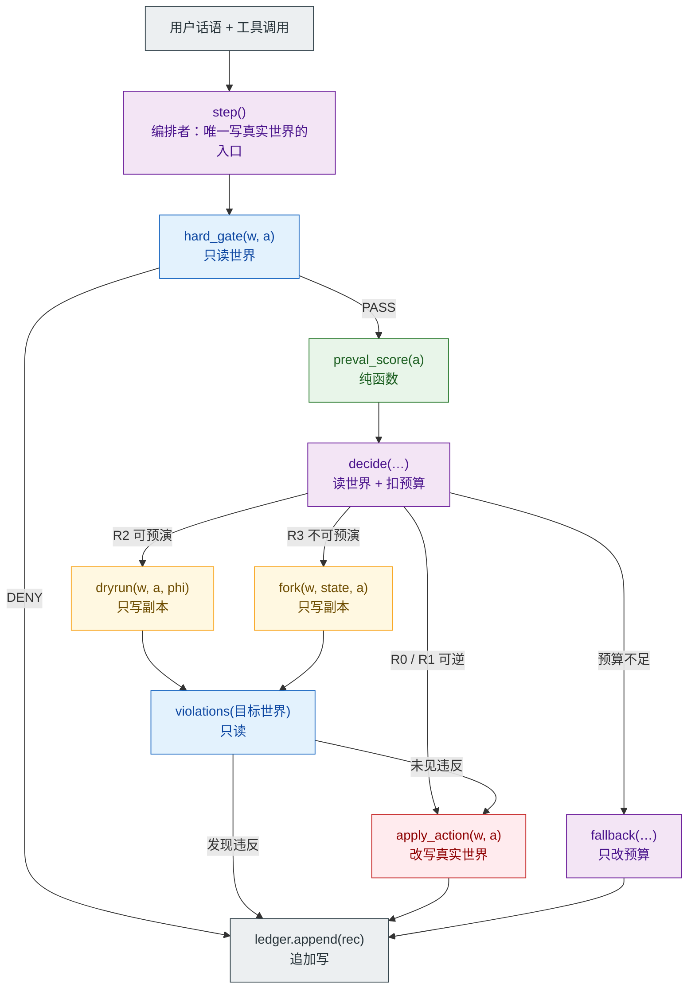
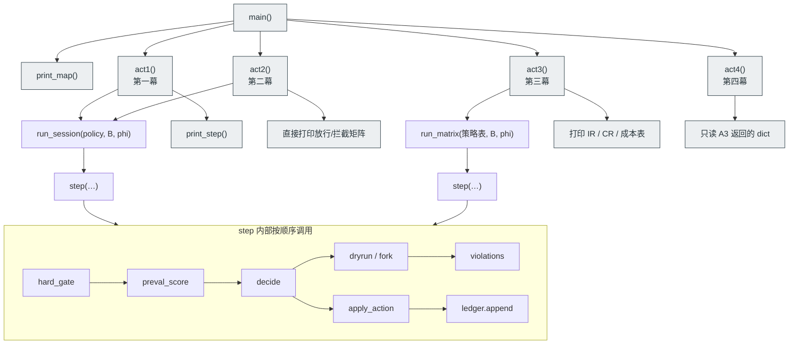
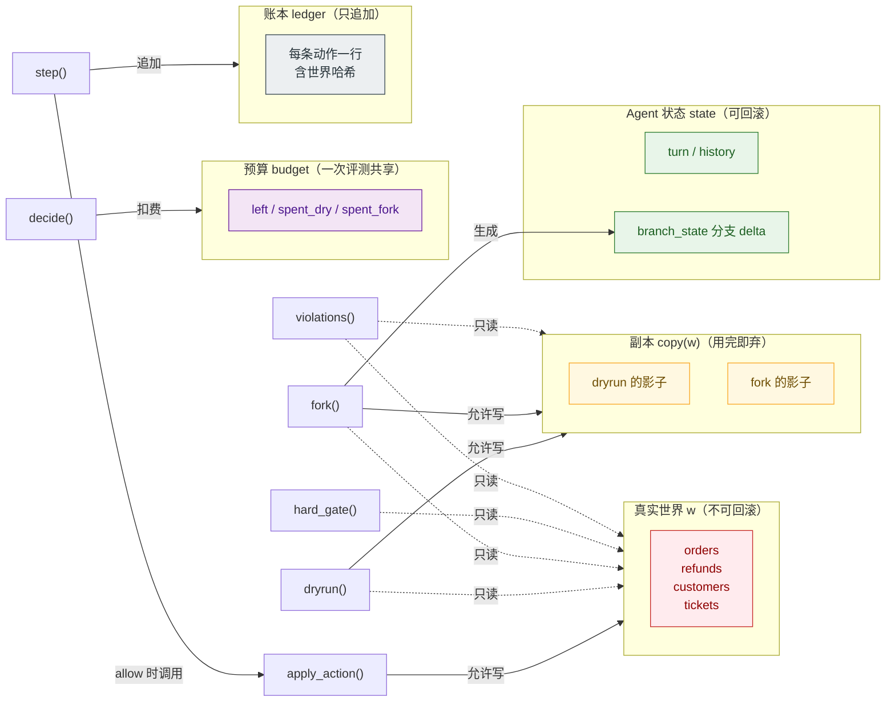
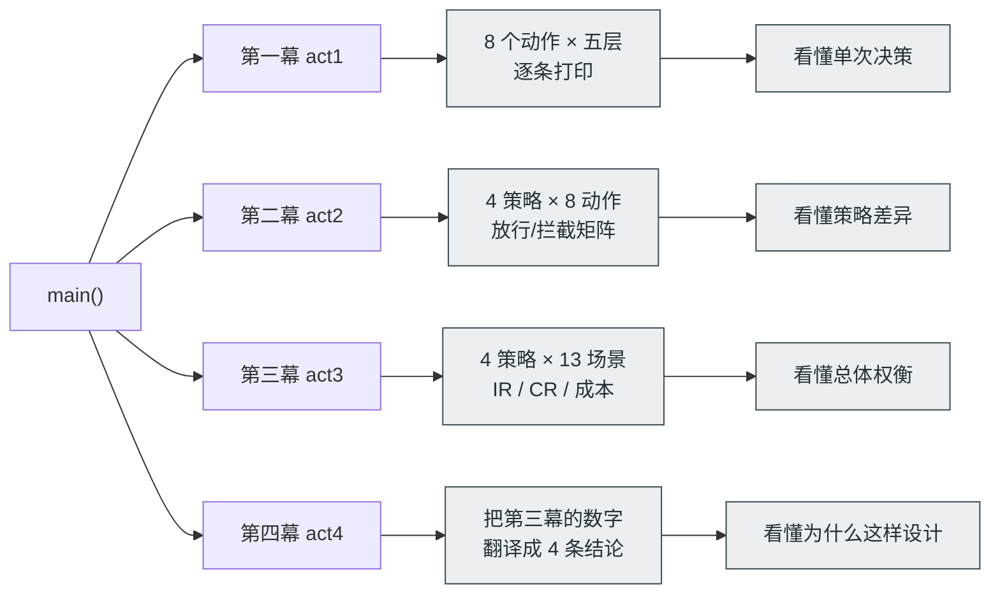

# 工作流程与函数作用域（Mermaid）

> 全部针对单文件版 [`harness_full_demo.py`](../harness_full_demo.py)。
> 行号会随改动漂移，随时用 `python harness_full_demo.py --map` 打印最新值。
> 四张图分别回答：**怎么串起来的**、**谁调用谁**、**谁有权改什么**、**四幕各输出什么**。

---

## 图 1｜一个动作的完整流程（函数级）

节点 = 函数，颜色 = 作用域。跟着箭头走一遍，就是一次动作的一生。

**读图要点**

1. 从 `step()` 出发，第一个遇到的是 `hard_gate`（不是 PreVal）。**顺序就是安全语义**。
2. `apply_action` 只有一个：它被 `step` 用来改真实世界，被 `dryrun` / `fork` 用来改副本。
   **同一个函数，两种作用域，区别只在传入的 `w` 是不是副本。**
3. 所有"判断危险"的结论都来自 `violations()`，而它只读、不改。
4. 出口只有一个：`ledger.append`。放行和拦截都走它。

---

## 图 2｜调用树：谁在什么时候调用谁

**读图要点**

- **只有 `act*` / `print_step` / `print_map` / `main` 会 `print`**。所有 `run_*`、`step`、`decide`、
  `fork`、`dryrun`、`hard_gate`、`violations` 里一行 `print` 都没有。
  这就是为什么它们可以被测试、被脚本复用。
- `run_session` 和 `run_matrix` 是同一个 `step` 的两个调用方：
  前者跑"一条会话"，后者跑"策略 × 场景矩阵"。**指标只在 `run_matrix` 里汇总**。

---

## 图 3｜作用域：五类数据，谁能写谁

这张图回答"为什么 fork 救不了已经发出去的副作用"。

**三条红线（图里看得很清楚）**

1. **只有 `apply_action` 能写真实世界**，而它只在 `step` 判定 `allow` 后、由 `step` 调一次。
2. **`dryrun` / `fork` 写的是副本**，虚线表示它们对真实世界只有读权限。
3. **真实世界没有任何删除/回滚接口**。所以"先把动作发出去、再靠 fork 撤回"在结构上就不可能。

> 如果你想亲手验证第 3 条：在任何一个分支里直接调 `apply_action(真实 w, …)`，
> 然后丢掉分支状态 —— 世界哈希仍然是变的。这就是 C1。

---

## 图 4｜四幕各自调什么、输出什么

---

## 函数清单：作用 + 作用域

| # | 函数 | 行号 | 作用 | 读 | 写 | 能打印吗 |
|---|---|---|---|---|---|---|
| 1 | `stable_unit` | 95 | 字符串 → [0,1) 确定性随机 | — | — | 否 |
| 2 | `jbytes` | 106 | 估对象字节数（喂成本模型） | obj | — | 否 |
| 3 | `world_hash` | 111 | 世界内容 → 12 位哈希 | w | — | 否 |
| 4 | `new_world` | 130 | 构造种子世界 | — | 新建 dict | 否 |
| 5 | `apply_action` | 167 | **唯一改世界的函数** | w | w（本体或副本） | 否 |
| 6 | `violations` | 273 | 检查 7 条后果不变量 | w | — | 否 |
| 7 | `hard_gate` | 330 | 确定性规则，单请求 | w + a | — | 否 |
| 8 | `preval_score` | 417 | 概率评分 | a | — | 否 |
| 9 | `dryrun` | 452 | 影子执行 + 按 φ 扰动 | w | 副本 | 否 |
| 10 | `fork` | 471 | 分叉状态 + 影子 + 计量 | w, state | 副本, branch_state | 否 |
| 11 | `decide` | 532 | 分级调度（核心决策） | w, state, budget | budget | 否 |
| 12 | `estimate_fork_cost` | 592 | fork 前估成本 | w, state | — | 否 |
| 13 | `do_fork` | 601 | 执行 fork 并扣费 | w, state | budget | 否 |
| 14 | `fallback` | 631 | 预算不足时降级 | — | budget | 否 |
| 15 | `step` | 647 | **编排五层 + 唯一副作用出口** | 全部 | 真实 w, state, ledger | 否 |
| 16 | `build_state` | 768 | 构造 Agent 状态 | — | 新建 dict | 否 |
| 17 | `run_matrix` | 787 | 策略 × 场景矩阵 | 场景表 | 无（返回统计） | 否 |
| 18 | `run_session` | 869 | 跑一条会话 | SESSION | 无（返回记录） | 否 |
| 19 | `print_step` | 886 | 打印一个动作的五层 | 记录 | stdout | **是** |
| 20 | `act1` | 936 | 第一幕 | run_session | stdout | **是** |
| 21 | `act2` | 961 | 第二幕 | run_session | stdout | **是** |
| 22 | `act3` | 998 | 第三幕 | run_matrix | stdout | **是** |
| 23 | `act4` | 1018 | 第四幕 | act3 的 dict | stdout | **是** |
| 24 | `print_map` | 1078 | 章节行号导航 | 源文件 | stdout | **是** |
| 25 | `main` | 1101 | 参数解析 + 四幕编排 | argv | stdout | **是** |

**规律**：

- 1–18 是**逻辑层**，一行 `print` 都没有 → 可测试、可复用、可换输出。
- 19–25 是**表现层**，只消费逻辑层的结果 → 想改输出只动这几个。
- 只有 5 号（`apply_action`）和 15 号（`step`）会碰真实世界，且 5 号永远是被 15 号替它调用的。

---

## 附：三个"作用域"常见误解

| 误解 | 实际 |
|---|---|
| "`decide` 会执行动作" | 不会。它只返回一个裁决字典，执行是 `step` 的事 |
| "`fork` 会回滚真实世界" | 不会。它只读真实世界，写副本 |
| "`violations` 会修复问题" | 不会。它只返回一个 `set`，修不修是调用方的事 |
